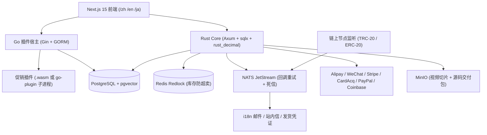
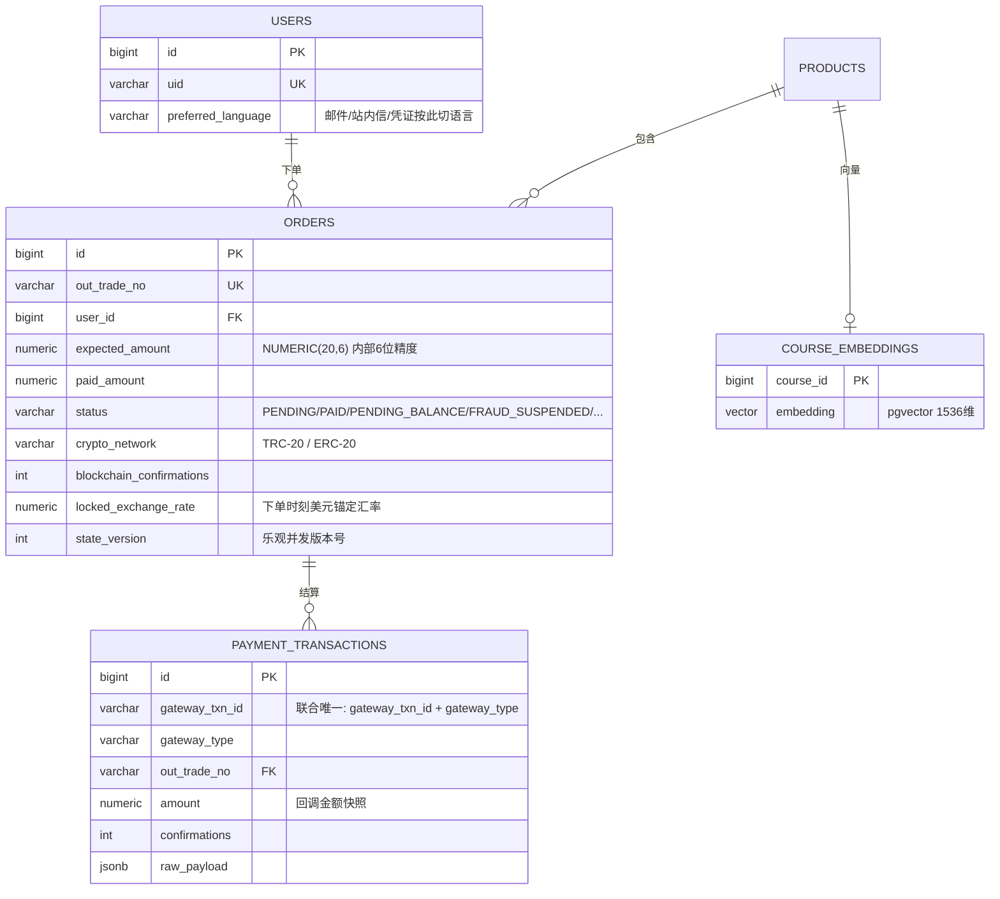
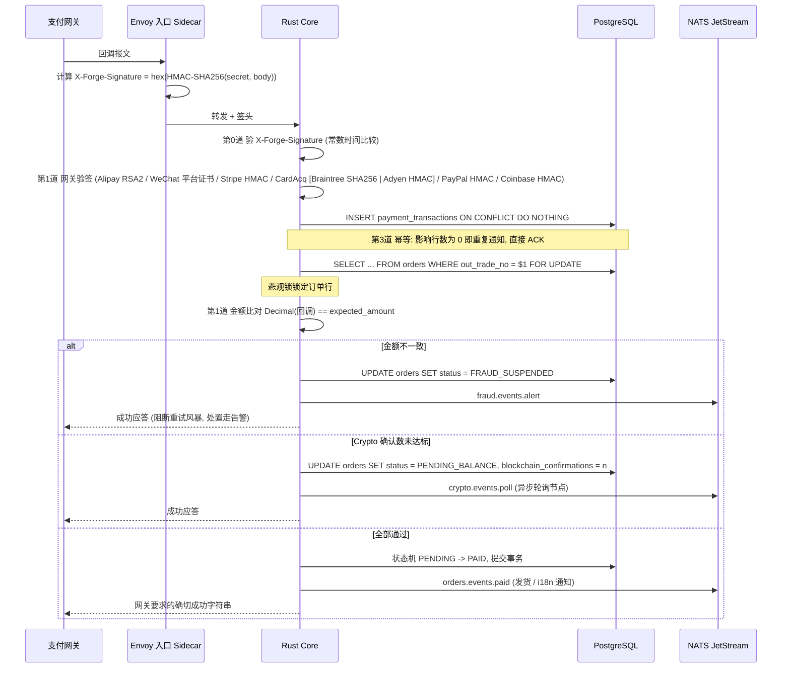
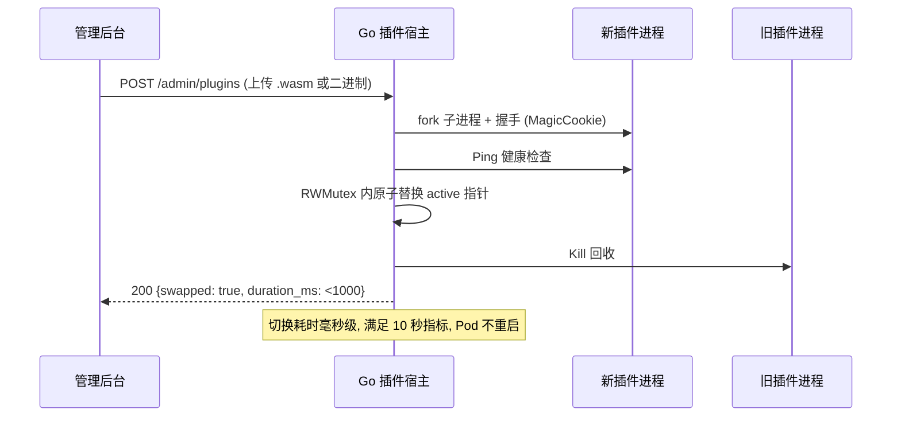

# EduForge-Neo 架构说明

## 1. 分层与模块划分

热插拔原则: 业务算法 (Promotion) 以独立进程 / Wasm 形式挂载, 主进程永远
稳定; 支付与资产域 (Core) 是信任边界, 任何模块都不得绕过 Core 直接写订单。

模块:

| 模块 | 宿主 | 说明 |
|---|---|---|
| Core | Rust | 订单状态机、金额精度、网关通信 (6 个模块化网关适配器), 唯一可写 orders 表的进程 |
| Catalog | Go | 商品目录 |
| Promotion | Go + 插件 | 优惠券 / 折扣算法, 热插拔 |
| Community | Go | 评论 / 问答 |

## 2. 核心实体 (ER)

DDL 位于 schema/001_init.sql。

要点:

1. `orders.expected_amount` 在下单时刻落库, 后续支付流程只认它。
2. `payment_transactions` 的 `(gateway_txn_id, gateway_type)` 联合唯一索引
   是防重放的终极防线, 由 `INSERT ... ON CONFLICT DO NOTHING` 原子认领。
3. Crypto 订单未达确认数前停在 `PENDING_BALANCE`, 由 NATS 消费者轮询节点。

## 3. 金库级支付验证 (三道死锁 + 入口封装)

关键决策:

- 金额全程 `rust_decimal::Decimal` / `NUMERIC(20,6)` / Go int64 微单位, 禁止浮点。
- 回调金额解析用 `Decimal::try_from_str`, 网关字符串直接进十进制, 不经过 f64。
- 网关应答策略: 已入库 (含欺诈挂起) 一律返回该网关要求的确切成功体,
  防止网关无限重试; 基础设施故障才回 5xx 触发重试。
- Alipay 回 "success", Stripe 回 200 "ok", WeChat 回 `{"code":"SUCCESS"}`, CardAcq (Braintree/Adyen) 与 PayPal 回 200 "ok", Coinbase 回 `{"code":"SUCCESS"}`。
- 网关适配器模块化: `gateway/{alipay,stripe,coinbase,wechat,paypal,cardacq}.rs`, 各网关独立文件 + 独立 config 密钥; 新增/更换网关 = 新增子模块 + `GatewayType` 变体 + 一条路由, 状态机/幂等/金额比对层零改动。
- 独立卡收单 (CardAcq) 为**双实现槽位**: `gateway/cardacq/{braintree,adyen}.rs` 各自独立, 由 `FORGE_CARD_ACQUIRER` (braintree|adyen, 默认 braintree) 一行切换, 两组密钥互不影响 (Braintree 商户号 / Adyen base64 HMAC key + 商户号)。Adyen 走官方 HMAC-SHA256 通知验签 (规范串 `pspReference:originalReference:merchantAccountCode:value:currency:eventCode:success`), 分位值以纯整数换算两位小数字符串, 全程不经过 f64。

## 4. 热插拔 (Promotion)

- 契约: `PromotionInterface.ApplyDiscount(price Decimal) (Decimal, result)`
  (Go 侧 Decimal 为 int64 微单位, 与 Rust 精度对齐)。
- 传输: HashiCorp go-plugin 的 net/rpc 协议 (gRPC/protobuf 亦可选)。
- Wasm 路线: 同一接口经 32 位 ABI 封装跑在 wasmtime 沙箱内, 宿主零 fork。

## 5. 全球化多语言

- 前后端共用 `apps/web/locales/*.json` (后端邮件/凭证由 NATS 消费者读取同包)。
- 用户表 `preferred_language` 驱动: 支付成功邮件、站内信、发货凭证四语言切换。
- 前端数字/日期走 `Intl.NumberFormat(locale)`: zh-CN + CNY 渲染 "￥3,000.00",
  en-US + USD 渲染 "$3,000.00"。
- 路由: /zh /en /ja (next-intl middleware), ko 保留给后端通知文案。

## 6. 数字交付防盗版

- 源码: 一次性授权码 = HMAC(uid + MAC 哈希 + 时间窗), 绑定用户与机器。
- 视频: M3U8 AES-128 切片, 解密 Key 经 /key 端点动态下发, 15 分钟有效 + IP 绑定。
- 下载: MinIO 预签名 URL, 5 分钟有效, 网关侧强制校验 Referer 与 Authorization。

## 7. 非功能性约束

| 约束 | 落实位置 |
|---|---|
| 对外 API P95 < 200ms | 回调热路径: 验签 ~2ms + 锁单 ~5ms + 写库 ~30ms, HPA 70% CPU 阈值留余量 |
| 货币 6 位内部精度 | NUMERIC(20,6) / rust_decimal / int64 micro-unit, 展示层统一四舍五入 2 位 |
| 全链路追踪 | Rust tracing (JSON, 经 otel-sidecar 上收) + Go otelgin/OTLP, 共享 W3C TraceContext |
| 回调应答契约 | 见 3 节: 成功体逐网关硬编码, 重试策略由应答码决定 |
